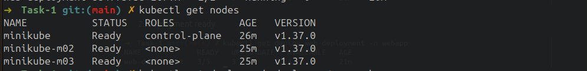
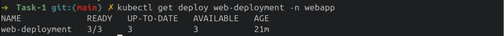
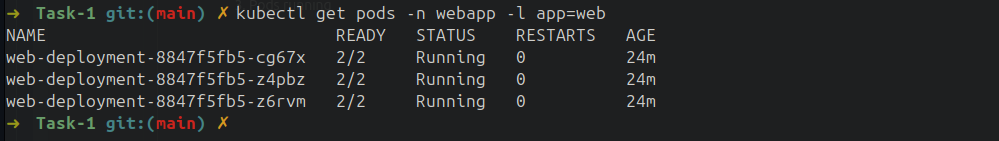
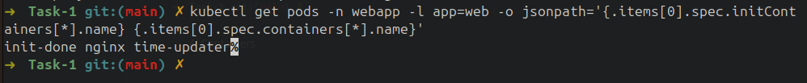
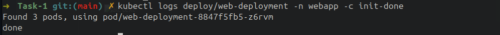
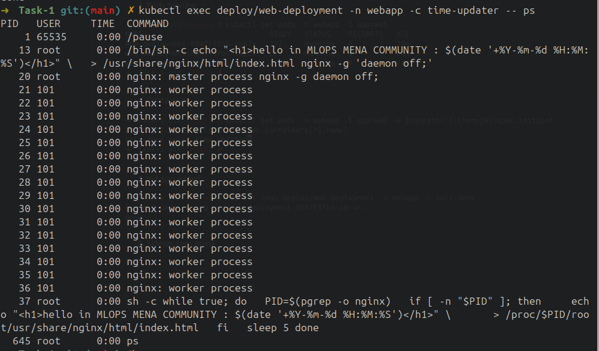
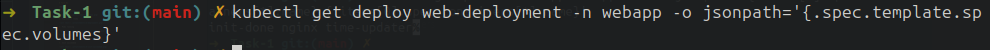
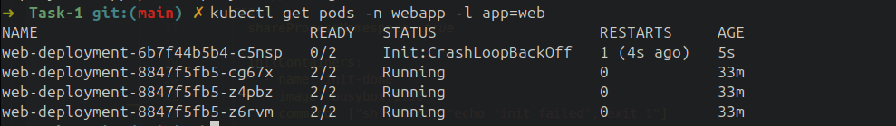
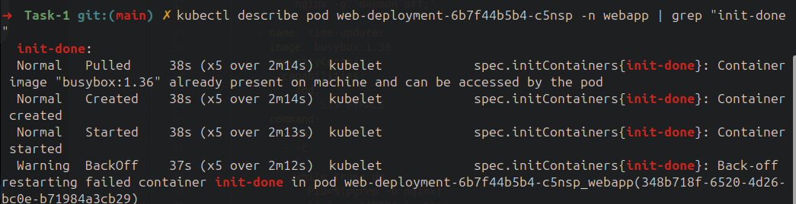
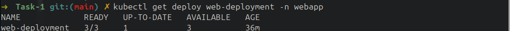

# Task 01

checks:

1. 3 Nodes Ready

2. Deployment ready

3. Pods running

4. Containers

5. Init succeeded

6. Sidecar sees nginx

7. Time updates - 5 seconds apart 

8. No volumes

9. Failing init

10. Init error details

11. Ready again
